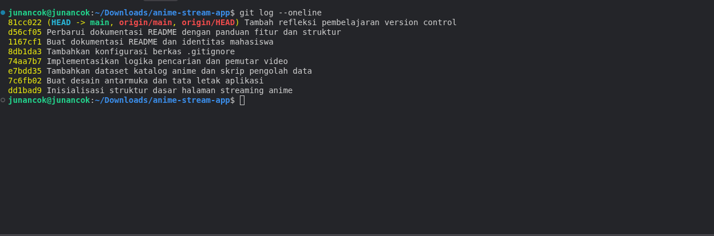
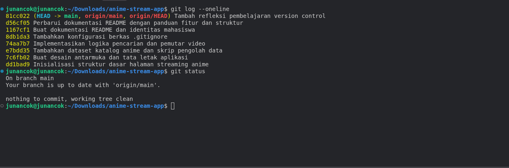

# Catatan Kolaborasi — 315251020003

Repositori tugas **Repositori Git Pertama** untuk mata kuliah Komputasi Kolaboratif. Isinya mencakup catatan pertemuan, refleksi penggunaan Git, dan proyek aplikasi web streaming anime.

- **Repositori GitHub**: [catatan-kolaborasi-315251020003](https://github.com/arjuna15/catatan-kolaborasi-315251020003)

- 🌐 **Live Demo Aplikasi**: [https://wibuinaja.vercel.app/](https://wibuinaja.vercel.app/)

## Identitas Mahasiswa
- **Nama**: Arjuna Arrasyid
- **NIM**: 315251020003
- **Program Studi**: Sistem Teknologi Informasi
- **Mata Kuliah**: Komputasi Kolaboratif

## Fitur Aplikasi
- Katalog anime interaktif dengan pencarian cepat
- Pemutar video streaming terintegrasi
- Tampilan antarmuka responsif untuk desktop dan perangkat seluler

## Struktur Repositori
- `index.html`, `styles.css`, `app.js`: Berkas antarmuka dan logika aplikasi streaming anime.
- `anime_catalog.json`: Basis data katalog anime.
- `catatan-pertemuan-1.md`: Ringkasan materi pengantar komputasi kolaboratif.
- `catatan-pertemuan-2.md`: Ringkasan materi groupware dan koordinasi alur kerja tim.
- `refleksi.md`: Refleksi pribadi mengenai alur kerja Git vs konvensional.
- `.gitignore`: Berkas konfigurasi pengabaian berkas sementara.

## Bukti Pengumpulan
### Riwayat Commit (`git log --oneline`)

### Status Repositori (`git status`)

